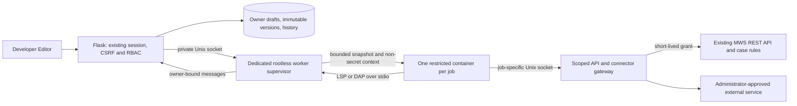

# Developer Workspace

MWS now uses a shared left sidebar. Collapse it for icon-only navigation; on
small screens the header menu opens a drawer (Escape dismisses it). Sidebar
preferences are stored locally for each user. Existing case
Workbench tabs, URLs and case-state restrictions remain authoritative.

Developer contains **API**, **SDK**, **Editor**, and **Plugins**. `/api` remains compatible;
`/developer/api` is an alias for the same Swagger implementation. SDK pages
render the shipped guide and generated reference, not a second SDK manual.
Use section search, anchors, and code-copy controls. Documentation access does
not grant permission to invoke the documented endpoints.

## Access

Administrators receive all Developer permissions. Other roles need explicit
`developer:api`, `developer:sdk`, and/or `plugins:read`. Plugin operations also
require their corresponding permission: `plugins:create`, `edit`, `validate`,
`test`, `execute`, `debug`, `publish`, `versions`, `delete`, or `configure`.
Every workspace endpoint enforces these permissions. Drafts and histories are
owner-scoped, including for administrators. Runtime access is the intersection
of the initiating user's current RBAC and the manifest's requested permissions.

## Plugins management

Developer → Plugins (`/plugins`) is a management page, separate from Editor.
Place a package in a child directory of the application's `plugins` directory
(or configure `MARE_PLUGINS_DIR`), then Refresh. Discovery validates manifests,
paths and package budgets without importing or executing Python. Unrelated
folders are ignored; invalid packages and conflicts appear separately.

Discovery registers new packages as disabled, unpublished, owner-scoped drafts
in the existing SQLite registry; importing requires `plugins:create`. Existing
registrations are never overwritten by refresh. The registry is the authoritative
editable package: editing changes its transactional snapshot, not the original
installation directory. Filesystem changes to an already registered package are
not automatically reloaded. Existing registry packages remain available.

The full-height Control Center has an independently scrolling inventory and
five detail tabs: Overview, Configuration, Permissions, Dependencies and Activity.
Search by name, identifier or description; filter All, Enabled, Disabled or Errors.
Invalid registered drafts remain visible with their error state. Filesystem discovery
errors appear separately. New Plugin uses the existing templates and create API.
Select a package to inspect its manifest, declared permissions, SDK/API contract,
configuration schema, dependencies and enabled state. Missing metadata says
“Not specified.” Compatibility here checks the declared contract; installed
worker dependencies are checked by isolated validation.

**Enable** preserves the existing publication gate. For a new package it runs
isolated validation and tests, publishes the exact checked revision, then enables
it. This requires validate/test/publish/versions permissions and a working worker.
Already published packages use the existing enable operation. **Disable** stops
future published runs; existing executions continue on their immutable snapshots.
**Edit in Editor** opens the selected identifier in Editor. Invalid drafts can be inspected,
repaired, or disabled without reloading an unsafe draft over an installed version.

Right-click an inventory entry (or press Shift+F10 / the Menu key) for Enable,
Disable, Edit and Delete. The menu selects that entry, supports arrow keys,
Home/End, Escape, and outside-click dismissal. Invalid packages cannot be enabled.
Delete requires confirmation and `plugins:delete`. Imported packages move into
`PLUGINS_DIR/.mws-deleted/<identifier>-<unique-id>`; registry snapshots, execution
history and audit records remain. Existing executions continue on immutable
snapshots. Administrators can recover files from that directory; restoring a
registration requires an administrator to clear its soft-delete state after
review. Application built-in tools are outside this registry. Set the server
configuration `PROTECTED_PLUGIN_IDS` to a collection of registered identifiers
that must not be deleted; the API enforces it regardless of browser controls.
The browser sends only the registered identifier and revision, never a deletion
path. Recovery directories and package symlinks are never followed.

Configuration renders the declared types, enum choices and required fields. Save
uses the existing configuration API; Reset changes discards only unsaved inputs.
Configured secret values are never displayed, returned or stored in browser
preferences. Blank secret inputs preserve existing values; explicit clear controls
remove them. Permissions distinguishes declared scopes from currently authorized
scopes. Activity lists the initiating owner’s recent executions, status and duration.

## Viewport layout and preferences

Both pages fill the available viewport below the actual application header. Only
inventory, details, explorer, CodeMirror and console contents scroll. The resizable
inventory divider remembers its preferred width. In Editor, drag the explorer
separator horizontally and the console separator upward to allocate space; these
separators also support arrow keys and Home/End. The console consumes editor space
without extending the page. The explorer can be hidden with its toolbar toggle.

Workspace preferences are scoped to the signed-in user in browser storage: explorer
width/visibility, console height/open state/tab, word wrap, last package and optional
sidebar collapse. The gear menu controls word wrap and optional sidebar collapse.
Automatic sidebar collapse is off by default and restores the prior state on exit.
Source files, configuration values, secrets and logs are never saved in preferences.
Plugins → Edit in Editor and Editor → Plugins preserve the selected identifier;
plugin switches have browser history and use the existing unsaved-buffer guard.

## Editing and running

1. Open a package through **Edit**, or select it in Developer → Editor. The left
   explorer provides files, folders, refresh and authorized create/rename/delete
   operations. Open text files in multiple CodeMirror tabs. Binary files remain
   downloadable. Paths are confined to the package on the server.
2. Edit Python, JSON, YAML, TOML, Markdown and text. Use **Save** or Ctrl/Cmd+S.
   Unsaved buffers have indicators. Navigation offers Save, Discard and Cancel;
   revision conflicts retain your local edits. Invalid manifests are saved as
   repairable drafts with validation errors, preserving enable/publication state.
3. Python intelligence starts automatically using isolated basedpyright and the
   installed SDK types. Type a period to open real member completion; accept with
   Enter or Tab and dismiss with Escape. Hover shows documentation; typing an
   opening parenthesis/comma shows signatures. Ctrl/Cmd+Shift+Space requests a
   signature. Diagnostics track document changes. A missing worker produces an
   explicit error instead of invented suggestions. No SDK panel is required.
4. **Run** saves changes and executes the manifest entrypoint from the saved,
   unpublished immutable snapshot. It does not publish or enable the package.
   No case selection or investigation session is required. `context.case_id` is
   None. SDK calls may read authorized cases when explicitly programmed and
   declared; development runs cannot mutate cases or access administration APIs,
   external connectors or case assets. Required configuration can be managed in Plugins → Configuration.
5. Run opens the collapsible, vertically resizable Console. **Output** contains
   stdout, print statements, results and run lifecycle messages. **Debug** contains
   stderr, tracebacks, plugin logs, validation and runner diagnostics. Status and
   elapsed duration remain visible. Both tabs support clear, copy, automatic
   scrolling and manual review. Debug is a diagnostic log, not an interactive
   debugger. The backend debugger and version APIs remain available to authorized
   integrations, but are not controls in this editor.

## File Explorer

The project tree replaces the old file list. Folders have distinct closed/open gold
SVG icons; file-type glyphs share one original MIT-licensed SVG set (no external
icon/font dependency). Python uses blue/yellow; configuration, code and document
formats have their own colors, including special package/manifest filenames.

Click a file to open it; use chevrons to expand folders. Ctrl/Cmd-click toggles
selection and Shift-click selects a range. Arrow keys, Home/End and type-ahead
navigate the tree; Enter opens the focused file. These shortcuts apply only while
the Explorer has focus, leaving CodeMirror shortcuts intact.

The compact header and folder context menus provide **New File** and **New Folder**
with inline naming. F2 or **Rename** selects the stem without the extension; Enter
confirms and Escape cancels. Right-click an item or use Shift+F10 for a keyboard
menu; arrow keys navigate, Escape dismisses it. Empty-space menus operate on the
package root. File menus retain **Download** for binary and text resources.

Use Ctrl/Cmd+X/C/V for an internal, package-scoped clipboard. Cut items dim until
pasted or canceled with Escape. Copy/paste duplicates saved package bytes under
an unused `copy` name; it does not copy unsaved editor text or replace existing
files. Drag files/folders to folder rows or the project root; valid targets turn
blue and invalid targets are marked. Hovering opens collapsed folders, and edge
dragging scrolls the tree. Multiple selected items move in one transaction.

Moves/renames rekey open tabs while retaining unsaved text and undo history.
Refresh preserves local buffers, selection and expanded folders. Structural
changes restart the isolated language session against the updated snapshot.
Renaming/moving/deleting the entrypoint warns that its manifest reference must be
updated; Python imports are never rewritten. The root `plugin.json` can be edited
and copied but cannot be moved, renamed or deleted.

Deletion asks for confirmation and warns about descendants and unsaved tabs.
It closes affected tabs after the server confirms success. There is no recycle bin;
deletes cannot be undone through the Explorer. Back up important source first.
All operations affect the existing virtual registry package, never arbitrary host
paths. The backend validates every source/target, rejects descendant moves and
collisions, enforces size limits and RBAC, audits operations, and uses the existing
revision compare-and-swap transaction for atomic multi-item changes.

## Manifest and compatibility

```json
{
  "schema": "mws-plugin/1",
  "id": "hello_research",
  "name": "Hello research",
  "description": "Read one authorized case",
  "version": "1.0.0",
  "author": "Analyst",
  "entrypoint": "main.py:run",
  "api_version": "v1",
  "sdk_version": ">=1,<2",
  "plugin_api": "1",
  "permissions": ["cases:read"],
  "dependencies": [],
  "configuration": {}
}
```

The entrypoint receives the typed `mws_sdk.plugin.PluginContext`. Its `client`
is the actual MWSClient; `case_id`, `inputs`, `configuration`, `dry_run`, `log`,
and `external` form plugin API 1. Use implemented SDK methods, not direct database/backend imports.

Dependencies are declarations, not installation instructions. Administrators
must review and install dependencies into a new worker image, pin its digest,
and redeploy. URL, local-path and arbitrary pip-option dependencies are rejected.
REST v1, SDK major 1 and plugin API 1 are required. Increment the manifest version
before publishing changed source; published semantic versions cannot be replaced.
Validation/test results are bound to all file paths, contents and directory flags.

Configuration fields support string, finite number, boolean, enum, defaults and
required flags. Example: `"api_key":{"type":"string","secret":true}`. Use Plugins → Configuration to enter values. Secret inputs are encrypted using the existing
site key and AES-256 ZIP support; stored values are never returned to the browser
or placed in container environment/context. Keep environment-provided site keys
available during restore, as with existing complete-backup signing/encryption.
Changing that key requires deliberate secret re-entry or a managed key migration.

Approved external connectors are configured by the worker administrator, for
example `MARE_DEVELOPER_CONNECTORS_JSON`:

```json
{"research":{"origin":"https://research.example","secret_field":"api_key","header":"Authorization","prefix":"Bearer "}}
```

`context.external("research", "/health")` performs a bounded GET through the
supervisor. No caller-supplied host, redirect, query string, header, or credential
is accepted. Secrets stay outside debuggee memory and are redacted from connector
responses. Network access is unavailable in development sessions. Connector
administrators must approve services and their response contents.

## Import, export and backups

Plugin ZIPs include source, manifest, docs, dependency declarations and resources.
Exports exclude separately stored configuration/secrets and execution history.
Do not hardcode secrets into source files. Imports enforce 200 entries, 2 MiB per
file and 20 MiB total, reject unsafe/reserved paths, case collisions, file-parent
conflicts, links, special files and encrypted entries, and validate compatibility
without executing code. Imports create disabled, unpublished drafts. Identifier
collisions must be resolved explicitly, never overwritten silently.

The idempotent `developer-package-discovery-v1` migration adds an optional source
location to existing registrations without modifying snapshots or state.
The `developer-workspace-v1` migration adds draft/file/version,
execution and grant tables before backup schema discovery.
Complete installation backups include their SQLite records; selective profile
or case archives do not implicitly export plugin code or secrets. Older complete
installation backups follow the existing schema-upgrade-before-replacement rule.
Standalone plugin ZIPs are portable across compatible MWS installations.

## Deploying the isolated worker

For rootless Docker, use the complete [Docker worker setup](DEVELOPER_DOCKER_WORKER.md),
including service units, image build, health checks, troubleshooting and real execution probes.
The Podman setup below remains supported.

The web environment requires **no** Pyright/debugpy/container-engine dependencies.
Without a configured worker, execution, isolated validation, language intelligence
and debugging return 503; draft editing, static checks and docs remain available.
There is no virtualenv/subprocess fallback in Flask.

Deploy on Linux with cgroup v2, rootless Podman, subordinate UID/GID ranges and a
dedicated unprivileged `mws-worker` account. Run the supervisor separately from
Gunicorn. The account must not receive access to application data or secrets.
Install only the `developer_worker` package under `/opt/mws-worker`; the supervisor
uses Python's standard library. Build the image from the repository root:

```sh
podman build -f developer_worker/Containerfile -t localhost/mws-developer:reviewed .
podman image inspect localhost/mws-developer:reviewed --format '{{.Digest}}'
```

Use its actual immutable `repository@sha256:…` reference in `MARE_DEVELOPER_IMAGE`.
The supervisor refuses mutable tags, a rootful engine, disabled seccomp, or
missing cgroup v2 CPU/memory/PID controllers. No image pulls
or dependency installs happen when accepting user jobs. Image-only dependencies
are basedpyright 1.38.4, debugpy 1.8.20, pytest 9.0.2, httpx 0.28.1, packaging 26.0,
and the built SDK. Rebuild reviewed images for dependency updates.

Create `/run/mws-developer` with a dedicated group shared by the web and worker
accounts. Grant only those accounts socket access (directory 0770, socket 0660).
Install the supplied `deploy/mare-developer-worker.service` as a worker **user**
service; enable lingering if required by the host. Configure its environment file:

```sh
MARE_DEVELOPER_IMAGE=localhost/mws-developer@sha256:REPLACE_WITH_ACTUAL_DIGEST
MARE_WORKER_API_ORIGIN=https://mws.internal.example
```

Set `MARE_DEVELOPER_WORKER_SOCKET=/run/mws-developer/worker.sock` for Gunicorn.
The API origin is administrator-controlled HTTPS, accessible by the supervisor,
with a trusted certificate. Containers never connect to it directly. For a worker
on a separate machine, provide a separately secured Unix-socket transport/tunnel;
do not expose the supervisor or debug ports as a public HTTP service.

Each container runs as UID 10001, with no network, read-only root filesystem,
all capabilities removed, no new privileges, 64 processes, one CPU, 512 MiB RAM,
no extra swap, bounded tmpfs, no core dumps, and bounded file descriptors. It sees
only its snapshot, non-secret inputs, and job-specific API socket. No engine
socket, database, host source tree or credentials are mounted. Operational jobs
expire after 60 seconds; language/debug sessions after ten minutes. Output is
limited to 256 KiB and retained worker jobs to one hour / 32 records, with four
simultaneous containers. Cancel and timeout kill the service-owned container.
Restarting the worker ends active jobs; web records expire after twelve minutes.

Keep default Podman seccomp confinement enabled. Provision the worker's home and
runtime directory with sufficient rootless storage and appropriate host quota.
Before enabling access, run the worker isolation test on the actual deployment:

```sh
MARE_TEST_WORKER_IMAGE=repository@sha256:ACTUAL_DIGEST PYTHONPATH=.:sdk .venv/bin/pytest -q tests/worker
```

This checks non-root UID, read-only root, blocked network, no host data/engine
socket mounts and no credential environment. The development Mac has no Podman
engine, so image startup, actual cgroup enforcement and end-to-end containerized
debugging must be verified on the worker host; unit contract tests cannot prove
those host properties.

## Checks and troubleshooting

- Run `.venv/bin/pytest` with `PYTHONPATH=.:sdk` for Python tests.
- Run `npm run build:editors` after frontend edits.
- Run `node tests/browser/developer-workspace.cjs` for disposable-data Chrome tests.
- Run `npm run test:developer-explorer` for actual registry-backed tree, drag/drop,
  clipboard, inline naming, unsaved buffer and keyboard checks.
- Set `MARE_TEST_DEBUG_PYTHON` to an isolated interpreter with debugpy and run
  `node tests/browser/developer-debug.cjs` for the real DAP fixture test.
- Set `MARE_TEST_LANGUAGE_SERVER` to an isolated basedpyright executable and run
  `node tests/browser/developer-language.cjs` to test real SDK language features.
- 403: verify the role's explicit documentation/plugin/data permissions.
- 409 on save: preserve your local buffer, refresh server metadata, and reconcile.
- 409 on publish: validate and test the exact saved fingerprint, then increment
  any previously published semantic version.
- 503: verify private socket ownership, worker service logs, immutable image,
  rootless engine and approved API origin. Never enable an insecure fallback.
- Missing imports: rebuild the approved worker image with reviewed dependencies.
- API failures: request the necessary manifest and user data permissions.
  Development runs are read-only; normal closed-case restrictions still apply.

## Architecture


