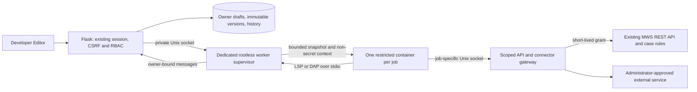

# Developer Workspace

MWS now uses a shared left sidebar. Collapse it for icon-only navigation; on
small screens the header menu opens a drawer (Escape dismisses it). Sidebar
and IDE panel preferences are stored locally for each user. Existing case
Workbench tabs, URLs and case-state restrictions remain authoritative.

Developer contains **API**, **SDK**, and **Editor**. `/api` remains compatible;
`/developer/api` is an alias for the same Swagger implementation. SDK pages
render the shipped guide and generated reference, not a second SDK manual.
Use section search, anchors, and code-copy controls. Documentation access does
not grant permission to invoke the documented endpoints.

## Access

Administrators receive all Developer permissions. Other roles need explicit
`developer:api`, `developer:sdk`, and/or `plugins:read`. Plugin operations also
require their corresponding permission: `plugins:create`, `edit`, `validate`,
`test`, `execute`, `debug`, `publish`, `versions`, `delete`, or `configure`.
Every workspace endpoint enforces these permissions. Drafts and histories are
owner-scoped, including for administrators. Runtime access is the intersection
of the initiating user's current RBAC and the manifest's requested permissions.

## Hello World tutorial

1. Open Developer → Editor and select **New Plugin**.
2. Enter a unique lowercase identifier such as `hello_research`, name, author,
   semantic version `1.0.0`, and a description. Choose **Hello World**. Request
   `cases:read` if the plugin should retrieve the selected case.
3. Create the draft. `main.py` opens automatically. The generated tree includes
   `plugin.json`, README, requirements, tests, and resources. Nothing is enabled
   or published automatically.
4. Edit Python, JSON, YAML, TOML, Markdown, or other UTF-8 resources. Binary files
   remain downloadable. Ctrl/Cmd+S saves all modified buffers. Navigation offers
   Save, Discard, and Cancel. A stale revision returns a conflict and retains the
   local buffer; refresh only after resolving or copying your edits.
5. **Check syntax** performs non-executing manifest/AST checks. **Connect Python
   intelligence** starts a dedicated basedpyright container when the worker is
   deployed. Use completion, hover, F12 for definitions, Shift+F12 for references,
   Ctrl/Cmd+Shift+Space for signatures, and Symbols for local symbols. Definitions
   in installed dependencies direct you to SDK documentation; plugin definitions
   open in the editor.
6. Choose an optional case ID and JSON inputs. **Validate in worker** checks
   installed dependency compatibility and imports/types with basedpyright,
   without calling the operational entrypoint. **Test** runs the plugin's pytest
   suite in a restricted container. API writes and external connections are
   denied in test, debug, and language sessions, regardless of plugin flags.
7. Click a Python gutter or press F9 to toggle a breakpoint. Debug Start creates an isolated
   debugpy session; Continue, Pause, Step Over/Into/Out and Stop control it. The
   current line, stack frames and scope variables appear in the workspace.
   Expression evaluation, conditional breakpoints, arbitrary launch arguments,
   and attaching to other processes are deliberately unavailable.
8. After isolated validation and testing pass for the exact current fingerprint,
   **Publish** stores an immutable version. Enable it separately. **Run published**
   uses that version's saved bytes, even if the draft subsequently changes.
   Review requested permissions in `plugin.json` before confirming execution.
9. Use execution history to inspect statuses, outputs and duration. Cancel revokes
   the job's API grant before asking the worker to stop. Versions / Rollback can
   select a prior immutable publication. Draft deletion disables its registration
   and preserves historical executions and published snapshots.

Tests default to real read-only case APIs. Tests can additionally use ordinary
httpx MockTransport fixtures; generated tests only check entrypoint availability.
A dry-run boolean is a convenience, never the security boundary. Production runs
alone may use declared write permissions, and normal closed-case rules still
apply on the server. Runtime tasks cannot access unrelated cases or global
administration APIs. Select an optional case artifact (up to 8 MiB) after entering the case ID.
The manifest must request `cases:assets`; only that selected asset can be
downloaded through `context.client.assets`, using `context.artifact` as its path.
Assets are transferred through the scoped API, never mounted from the host.

## Manifest and compatibility

```json
{
  "schema": "mws-plugin/1",
  "id": "hello_research",
  "name": "Hello research",
  "description": "Read one authorized case",
  "version": "1.0.0",
  "author": "Analyst",
  "entrypoint": "main.py:run",
  "api_version": "v1",
  "sdk_version": ">=1,<2",
  "plugin_api": "1",
  "permissions": ["cases:read"],
  "dependencies": [],
  "configuration": {}
}
```

The entrypoint receives the typed `mws_sdk.plugin.PluginContext`. Its `client`
is the actual MWSClient; `case_id`, `inputs`, `configuration`, `dry_run`, `log`,
and `external` form plugin API 1. Four wizard templates demonstrate Hello World,
indicator review, report generation and controlled external integration. They
use implemented SDK methods, not direct database/backend imports.

Dependencies are declarations, not installation instructions. Administrators
must review and install dependencies into a new worker image, pin its digest,
and redeploy. URL, local-path and arbitrary pip-option dependencies are rejected.
REST v1, SDK major 1 and plugin API 1 are required. Increment the manifest version
before publishing changed source; published semantic versions cannot be replaced.
Validation/test results are bound to all file paths, contents and directory flags.

Configuration fields support string, finite number, boolean, enum, defaults and
required flags. Example: `"api_key":{"type":"string","secret":true}`. Use
Configuration to enter values. Secret inputs are encrypted using the existing
site key and AES-256 ZIP support; stored values are never returned to the browser
or placed in container environment/context. Keep environment-provided site keys
available during restore, as with existing complete-backup signing/encryption.
Changing that key requires deliberate secret re-entry or a managed key migration.

Approved external connectors are configured by the worker administrator, for
example `MARE_DEVELOPER_CONNECTORS_JSON`:

```json
{"research":{"origin":"https://research.example","secret_field":"api_key","header":"Authorization","prefix":"Bearer "}}
```

`context.external("research", "/health")` performs a bounded GET through the
supervisor. No caller-supplied host, redirect, query string, header, or credential
is accepted. Secrets stay outside debuggee memory and are redacted from connector
responses. Network access is unavailable in development sessions. Connector
administrators must approve services and their response contents.

## Import, export and backups

Plugin ZIPs include source, manifest, docs, dependency declarations and resources.
Exports exclude separately stored configuration/secrets and execution history.
Do not hardcode secrets into source files. Imports enforce 200 entries, 2 MiB per
file and 20 MiB total, reject unsafe/reserved paths, case collisions, file-parent
conflicts, links, special files and encrypted entries, and validate compatibility
without executing code. Imports create disabled, unpublished drafts. Identifier
collisions must be resolved explicitly, never overwritten silently.

The idempotent `developer-workspace-v1` migration adds draft/file/version,
execution and grant tables before backup schema discovery.
Complete installation backups include their SQLite records; selective profile
or case archives do not implicitly export plugin code or secrets. Older complete
installation backups follow the existing schema-upgrade-before-replacement rule.
Standalone plugin ZIPs are portable across compatible MWS installations.

## Deploying the isolated worker

The web environment requires **no** Pyright/debugpy/container-engine dependencies.
Without a configured worker, execution, isolated validation, language intelligence
and debugging return 503; draft editing, static checks and docs remain available.
There is no virtualenv/subprocess fallback in Flask.

Deploy on Linux with cgroup v2, rootless Podman, subordinate UID/GID ranges and a
dedicated unprivileged `mws-worker` account. Run the supervisor separately from
Gunicorn. The account must not receive access to application data or secrets.
Install only the `developer_worker` package under `/opt/mws-worker`; the supervisor
uses Python's standard library. Build the image from the repository root:

```sh
podman build -f developer_worker/Containerfile -t localhost/mws-developer:reviewed .
podman image inspect localhost/mws-developer:reviewed --format '{{.Digest}}'
```

Use its actual immutable `repository@sha256:…` reference in `MARE_DEVELOPER_IMAGE`.
The supervisor refuses mutable tags, a rootful engine, disabled seccomp, or
missing cgroup v2 CPU/memory/PID controllers. No image pulls
or dependency installs happen when accepting user jobs. Image-only dependencies
are basedpyright 1.38.4, debugpy 1.8.20, pytest 9.0.2, httpx 0.28.1, packaging 26.0,
and the built SDK. Rebuild reviewed images for dependency updates.

Create `/run/mws-developer` with a dedicated group shared by the web and worker
accounts. Grant only those accounts socket access (directory 0770, socket 0660).
Install the supplied `deploy/mare-developer-worker.service` as a worker **user**
service; enable lingering if required by the host. Configure its environment file:

```sh
MARE_DEVELOPER_IMAGE=localhost/mws-developer@sha256:REPLACE_WITH_ACTUAL_DIGEST
MARE_WORKER_API_ORIGIN=https://mws.internal.example
```

Set `MARE_DEVELOPER_WORKER_SOCKET=/run/mws-developer/worker.sock` for Gunicorn.
The API origin is administrator-controlled HTTPS, accessible by the supervisor,
with a trusted certificate. Containers never connect to it directly. For a worker
on a separate machine, provide a separately secured Unix-socket transport/tunnel;
do not expose the supervisor or debug ports as a public HTTP service.

Each container runs as UID 10001, with no network, read-only root filesystem,
all capabilities removed, no new privileges, 64 processes, one CPU, 512 MiB RAM,
no extra swap, bounded tmpfs, no core dumps, and bounded file descriptors. It sees
only its snapshot, non-secret inputs, and job-specific API socket. No engine
socket, database, host source tree or credentials are mounted. Operational jobs
expire after 60 seconds; language/debug sessions after ten minutes. Output is
limited to 256 KiB and retained worker jobs to one hour / 32 records, with four
simultaneous containers. Cancel and timeout kill the service-owned container.
Restarting the worker ends active jobs; web records expire after twelve minutes.

Keep default Podman seccomp confinement enabled. Provision the worker's home and
runtime directory with sufficient rootless storage and appropriate host quota.
Before enabling access, run the worker isolation test on the actual deployment:

```sh
MARE_TEST_WORKER_IMAGE=repository@sha256:ACTUAL_DIGEST PYTHONPATH=.:sdk .venv/bin/pytest -q tests/worker
```

This checks non-root UID, read-only root, blocked network, no host data/engine
socket mounts and no credential environment. The development Mac has no Podman
engine, so image startup, actual cgroup enforcement and end-to-end containerized
debugging must be verified on the worker host; unit contract tests cannot prove
those host properties.

## Checks and troubleshooting

- Run `.venv/bin/pytest` with `PYTHONPATH=.:sdk` for Python tests.
- Run `npm run build:editors` after frontend edits.
- Run `node tests/browser/developer-workspace.cjs` for disposable-data Chrome tests.
- Set `MARE_TEST_DEBUG_PYTHON` to an isolated interpreter with debugpy and run
  `node tests/browser/developer-debug.cjs` for the real DAP fixture test.
- Set `MARE_TEST_LANGUAGE_SERVER` to an isolated basedpyright executable and run
  `node tests/browser/developer-language.cjs` to test real SDK language features.
- 403: verify the role's explicit documentation/plugin/data permissions.
- 409 on save: preserve your local buffer, refresh server metadata, and reconcile.
- 409 on publish: validate and test the exact saved fingerprint, then increment
  any previously published semantic version.
- 503: verify private socket ownership, worker service logs, immutable image,
  rootless engine and approved API origin. Never enable an insecure fallback.
- Missing imports: rebuild the approved worker image with reviewed dependencies.
- API failures: select a valid case and request the necessary data permission;
  tests/debugging cannot write, and closed cases must be reopened through MWS.

## Architecture


